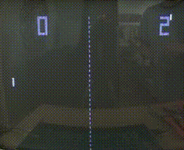

# Pong Game

- [Concepts](#concept)
- [Visuals](#visuals)
- [Game Mechanics](#game-mechanics)

[Wikipedia Link](https://en.wikipedia.org/wiki/Pong)

---

## Concept

Pong is the closest to the most simple representation of a tennis game watched from the top.
While the orientation is actually not important (regarding playable mechanics), the game is well-know for its horizontal orientation:
The ball travels from side to side instead of from top to bottom.

This is a two-player game, where each player should score as many point as possible to the other player.

## Visuals

### Elements

The game contains multiple elements, both visual and hidden:

- **Field divider**: A line in the middle of the playable area dividing both fields. This element is purely aesthetic.
- **Ball**: A pixel that moves from side to side, bouncing on the player paddle and the top and bottom walls. 
- **Player paddle**: Vertical bars on the side, that the player can use to bounce the ball onto them. These bars can move only vertically.
- **Player score**: Number (placed on each field) defining the goals scored by each player.
- **Goal area** (hidden): Non-visible element with a rectangular area right behind of each paddle.
- **Walls** (Optional): Lines defining the limits of the playable area, onto where the ball will bounce.

### Playable Area

#### Shape

The area is defined as a rectangular area, composed by two main areas:

- **Score count**: Placed right on top of the fields, where each score is then placed on top of each player's field. The score count is outside the fields to avoid the possibility the ball travels right under some of the numbers.
- **Fields**: Area where the ball will be able to travel. The fields will be limited by walls on all four sides.

#### Colors

While colors are not crucial for the game, this arcade will use three colors:

- **Player 1** (paddle and score) is colored blue `#0000FF`.
- **Player 2** (paddle and score) is colored red `#FF0000`.
- **Background** is colored black `#000000`
- **Other elements** are colored white `#FFFFFF`

## Game Mechanics

### Movement

There are two important movements in the development of the game:

- **Player**: Each player can move their own paddle up and down, within the field limits. The speed of each paddle is the same and always fixed.
- **Ball**: ...
