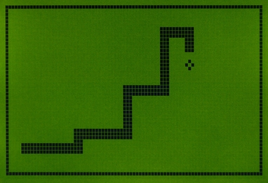

# Snake Game

## Concept

The `Snake Game` presents a simple area on the screen with two items in it: a line of pixels representing a snake and a single 'pixel' (representations may vary) representing the "orb" the snake must eat.
The **goal** of the game is to eat as many orbs as possible without dying.

## Visuals

The goal is to obtain a 'Snake Game' as similar as the one presented to at Nokia phones (see previous image).
At this section, some aspects are clarified to reach the intended goal.

### Pixels

While 'pixel' might not be the exact term, every time a 'pixel' is mentioned an area of 3x3 smaller pixels is actually defined as a reference.
The area of each pixel allows to represent multiple objects:

- **Snake body**: All 9 smaller pixels are colored.
- **Snake head**: Same as the body, with the difference that two corner pixels are not colored. The head also helps to visually identify the direction of the snake.
- **Orb**: Only 4 out of the 9 positions are colored, creating a circle. There are two possible combinations for this representation.
- **Walls**: The 3 most outer positions are colored.
- **Corners**: Only 1 position is colored, being this position the one in the corner.

| Object     | Representation                                               |
|------------|--------------------------------------------------------------|
| Snake Body | 
xxx xxx xxx
       |
| Snake Head | 
- x - xxx xxx
     |
| Orb 1      | 
- x - x - x - x -
 |
| Orb 2      | 
x - x - - - x - x
 |
| Wall       | 
xxx - - - - - -
   |
| Corner     | 
- - x - - - - - -
 |

> [!Note]
> Some representations (like the head) differ from the original game.
> This is intended.
 
### Playable Area

#### Shape

The area is defined as a rectangular area for simplifying the process.

#### Dimensions

There are no real limitations on the dimensions, other than an area big enough for the snake to be able to move.
To simplify the process, the dimension will be **fixed** at `720x640`.

#### Colors

Only two colors are to be used: one for background and one for coloring the position of each [pixel](#pixels).
These colors are to be black (`#000000`) and green (`#008000`) or olive (`#808000`), referencing to the colors displayed at the image within this document (Nokia Snake).
